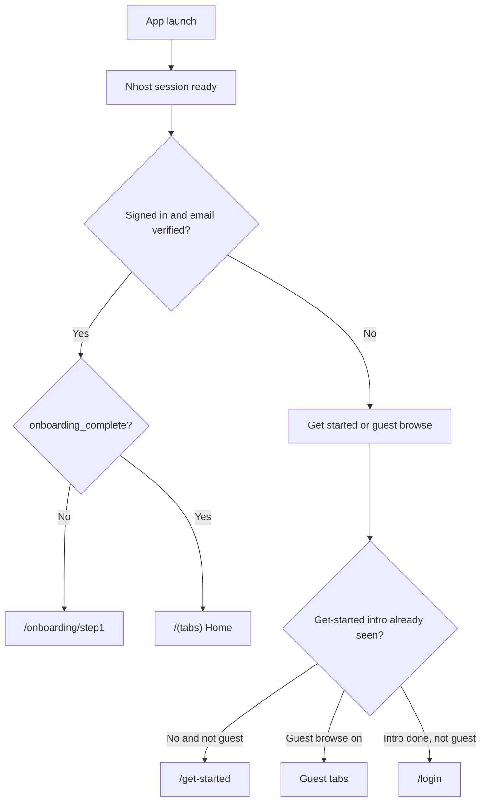
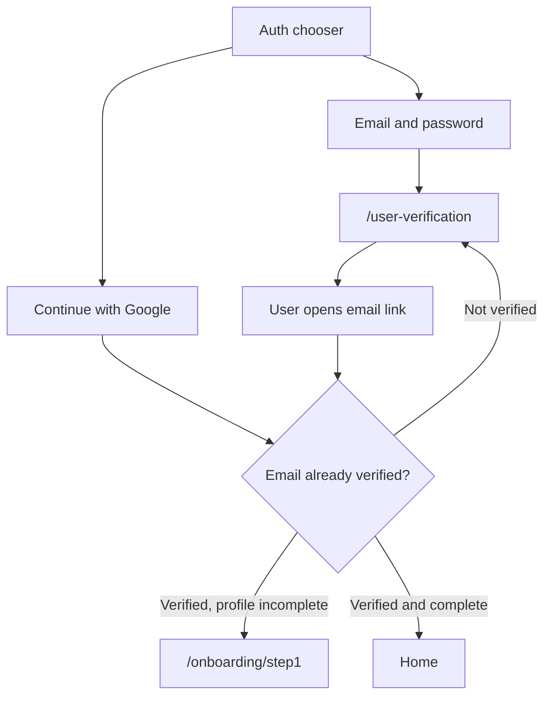
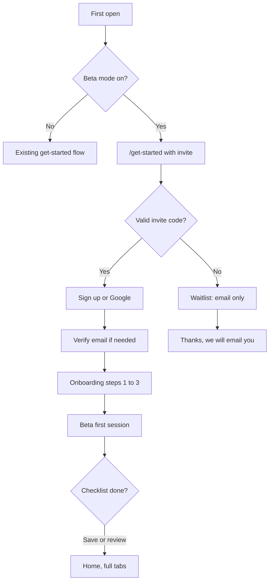

# Tastyplates Mobile — User Flows

**App:** `tastyplates-mobile` (Expo Router)  
**Status:** Current product flows, plus a proposed beta onboarding path that is not shipped yet.  
**Last updated:** 2026-10-04

Tastyplates is a restaurant discovery app built around taste identity. People browse by city and cuisine, read reviews from people whose palates match theirs, and publish their own notes from Studio.

This document maps the flows a person actually walks through in the app. Screen paths are Expo routes under `app/`.

---

## How the app decides what to show

On launch, session hydration finishes before any route renders (`SplashAuthGate`). Then three gates run in order.

| Person | Bottom tabs | Profile entry |
|---|---|---|
| Signed in, onboarding done | Home, Explore, Activity, Studio (+) | Avatar in the top bar |
| Guest browse | Home, Explore, Profile | Profile tab prompts sign-in |

Guests can look around. Writing a review, saving a restaurant, checking in, following someone, or opening Activity asks them to sign in.

---

## 1. First open and get started

**Route:** `/get-started`

Three slides:

1. Discover by your palate
2. Share your plates
3. Build your food world

From the last actions:

- **Create account / sign in** marks the intro as seen and opens the auth sheet.
- **Browse as guest** turns on guest mode and replaces the screen with Home.

Returning guests who already chose browse skip this screen. Signed-out people who finished the intro and did not choose guest browse land on `/login`.

---

## 2. Authentication

Auth is a sheet (chooser, sign-in, or sign-up), not a long stack of screens. `/login` exists mainly as the OAuth return route (`tastyplates://login`) and as a fallback that reopens the same sheet.

### 2.1 Create an account

- Email sign-up collects email and a password of at least 9 characters.
- After sign-up the app sends the person to `/user-verification` and waits for the email link.
- Google sign-in skips the password form. If the Google account is already verified, onboarding starts immediately.
- Forgot password is `/forgot-password`. The reset link opens `/reset-password`.
- Legal pages linked from auth: `/terms-of-service`, `/privacy-policy`, `/cookie-policy`, `/content-guidelines`.

Until `user.emailVerified` is true, `OnboardingGate` does not force onboarding. An unverified session can sit on the verification screen.

### 2.2 Sign in

Same sheet, sign-in mode: email and password, or Google. A successful session with `onboarding_complete === true` goes to Home. If the profile exists but onboarding is unfinished, the gate replaces the route with `/onboarding/step1`.

### 2.3 Sign-in wall inside the app

Protected actions open the auth sheet and remember a resume path. After success the person returns to that screen instead of being dumped on Home. Typical walls:

- Activity tab
- Studio actions (create review, manage reviews, lists)
- Save and check-in on a restaurant
- Follow, like, or comment
- Own profile from the top-bar avatar while signed out

---

## 3. Onboarding

**Routes:** `/onboarding/step1` → `step2` → `step3`  
**Done when:** `user_profiles.onboarding_complete` is true.

`OnboardingGate` runs this check for every verified session that is not already inside `/onboarding`. A local “just completed” flag prevents a redirect loop on the way to Home.

Draft answers are kept on device so leaving mid-flow does not wipe the username or city.

### Step 1 — Username

- Suggests a default username, or reuses one already on the profile.
- Checks availability as the person types.
- Username length is 3–20 characters.
- Continue stores the draft and opens step 2.
- Signed-out visitors are sent to login.

### Step 2 — Where you are, and where you are from

- **Current location** sets the city used for restaurant browse. Choosing it also updates the in-app location preference.
- **Hometown** is stored with the profile. It is the place the person grew up, not the city they are browsing.
- Both use the city picker (preset cities plus search).
- Continue requires a current location, then opens step 3.

### Step 3 — Palate

- “Select a cuisine you grew up with.”
- Up to **2** leaf cuisines (Chinese, Korean, Italian, and so on). These are identity slugs, not taste words like spicy.
- Search filters the list.
- **Done** writes the profile (username, locations, palates), sets `onboarding_complete`, clears the draft, refreshes the session, and replaces the stack with Home.

Skipping steps is only available when `DEV_MODE` is on. Production requires the three steps.

---

## 4. Home

**Route:** `/(tabs)` (`app/(tabs)/index.tsx`)

Top bar: city on the left, cuisine search and profile avatar on the right.

The page, top to bottom:

1. Brand mark
2. Hero (recent / local prompt)
3. Quick finds (cuisine shortcuts)
4. Featured restaurants for the selected city
5. Recent reviews
6. Articles

Pull to refresh reloads featured restaurants, reviews, and articles.

Changing the city in the top bar changes which restaurants Home and Explore show. Cuisine search opens a sheet; picking a cuisine goes to Explore or a cuisine listing with that filter applied.

---

## 5. Explore restaurants

**Route:** `/(tabs)/restaurants`

### Browse

- List is scoped to the selected city and radius.
- Filters: cuisine, category, and keyword search.
- Results mix Tastyplates restaurants and nearby Google places that are not listed yet.
- A cuisine filter personalizes ranking for signed-in people whose palate overlaps that cuisine. Cards can show a match score.
- Infinite scroll and pull to refresh.

### Restaurant detail

**Route:** `/restaurants/[slug]`

What the person sees:

- Photos, name, address, cuisine and price
- **Ratings row**
  - **Overall Score** — platform reviews plus the Google rating prior. Does not change when reviewer cuisine is edited.
  - **Search / group score** — if they arrived with a cuisine filter, this is that cuisine’s score (labeled Your Score when it is personalized). With no filter, a signed-in person sees their cuisine **group** score, for example “East Asian Score” when their palate is Chinese or Korean. It stays locked until that group has at least 3 reviews.
  - **Authentic Score** — reviews whose author cuisine matches the restaurant. External reviews count here after a rating rebuild.
  - **Shared Score** — unlocked when at least 3 reviews come from people who share the user’s palate.
- Actions: write a review, save, check-in. Save and check-in require sign-in.
- Review previews, then the full list
- Map, phone, website or menu, about text

### Google-only place

**Route:** `/places/google/[place_id]`

Same detail shell for a place that is not a Tastyplates restaurant yet. Overall falls back to the Google rating. Preference scores stay empty. Write a review starts Studio with that place prefilled so it can be created as a listing.

### Cuisine listing

**Route:** `/restaurants/cuisines/[slug]`

A cuisine-scoped browse, used from quick finds and cuisine search.

---

## 6. Reviews

### Read

- Home review rail and restaurant review list open the viewer at `/reviews/viewer`.
- A restaurant’s full list is `/reviews/restaurant`.
- Comments are `/reviews/[reviewId]/comments`.
- Hashtag taps open `/hashtag/[hashtag]`.

### Write

Studio **Create a Review** (`/studio/add-review`):

1. Search or pick a Tastyplates restaurant, or a Google place.
2. Write the note: title, body, rating, up to 6 photos.
3. Publish.
4. Success screen (`/studio/add-review/success`).

Editing an existing note is `/studio/edit-review/[id]`. Drafts and published notes are listed at `/studio/review-listing`.

Guests who tap write are sent through the auth sheet, then resumed into the composer.

---

## 7. Activity and people

**Route:** `/(tabs)/following`

Signed-in only. The feed is reviews from people the user follows. Opening the tab while signed out opens the auth sheet.

From a review or profile:

- Follow and unfollow
- Public profile: `/profile/[userId]`
- Their reviews, followers, and following
- Own profile: top-bar avatar → `/profile`
- Edit profile: `/profile/edit` (name, photo, about, location)
- Edit palates: `/profile/edit-palates` (same 2-cuisine limit). Saving palates rebuilds scores for restaurants that person has reviewed.

---

## 8. Studio

The center **+** tab opens a sheet. It is not a normal screen.

| Action | Route | What it does |
|---|---|---|
| Create a Review | `/studio/add-review` | New taste note |
| Manage Reviews | `/studio/review-listing` | Drafts and published notes |
| Manage Lists | `/studio/manage-lists` | Create and edit playlists |
| Saved lists | `/studio/my-lists` | Lists the person keeps |

List detail (`/studio/manage-lists/[uuid]`) can add restaurants, edit the title, or remove places.

There is also a longer “add a restaurant” listing flow under `/listing` (explanation, step 1, step 2, draft) for submitting a place that is not in the catalog yet.

---

## 9. Articles

**Routes:** `/articles`, `/articles/[slug]`

Home links into editorial stories. Reading an article does not require an account. Articles are separate from reviews; they do not change restaurant scores.

---

## 10. Settings and account

**Route:** `/settings`

- Account and security → profile fields, change password
- Language
- About
- Policies (terms, privacy, cookies, content guidelines)

Sign out clears the Nhost session. The next launch follows the get-started / guest / login gates again. Onboarding is not shown again if `onboarding_complete` is already true.

---

## 11. Scores, in one pass

These four numbers are what restaurant detail is built to explain. They are not four views of the same average.

| Label | Who it is for | What moves it |
|---|---|---|
| Overall | Everyone | First-party reviews and the Google rating prior |
| Group / Search | Signed-in person, based on their palate’s cuisine group | Combined palate summary for that group (for example East Asian) |
| Authentic | Everyone | Reviews whose reviewer cuisine matches the restaurant, including curated external reviews |
| Shared | Signed-in person | Reviews from people who share their palate, once there are at least 3 |

A person with Chinese or Korean selected sees East Asian as their group score when no cuisine filter is active. If they browse with a cuisine filter, that filter wins and the column becomes Search Score or Your Score instead.

---

## 12. Beta onboarding (proposed)

This flow is a design for the first invited cohort. It is **not implemented**. The screens below reuse get-started, auth, and the three onboarding steps, and add a gate in front of open registration.

### Intent

The first users should be people we can trust to set a real palate and publish a real first note. The app stays closed to the public until that cohort has finished a short guided start. After the cohort is in, the invite gate comes off and the normal get-started flow is the front door.

### Who gets in

| Person | What they can do |
|---|---|
| Has a valid invite | Full sign-up, onboarding, and the beta first-session tasks |
| No invite | Waitlist only. They cannot create an account. |
| Already finished beta tasks | Normal app. No repeat of the beta checklist. |

Invites are single-use codes or magic links tied to an email. Each code is issued by the team (a spreadsheet or admin tool is enough for the first batch). A code expires and cannot be reused.

### Proposed path

### Step by step

1. **Closed splash.** Same three get-started slides, plus one line: “Tastyplates is in private beta.” Primary button is **I have an invite**. Secondary is **Join the waitlist**.
2. **Invite code.** One field. Submit checks the code before any account is created. Invalid or used codes stay on this screen with a plain error. Valid codes are bound to the email they sign up with.
3. **Account.** Existing auth sheet: email or Google. The invite is consumed only after the account exists and the email matches.
4. **Verify.** Unchanged `/user-verification` for email sign-up.
5. **Onboarding steps 1–3.** Unchanged: username, current city and hometown, up to two palate cuisines. Beta copy on step 3 should say why it matters: “This is how we pick the East Asian, European, or other group score you see.”
6. **Beta first session.** A single checklist on Home, not a new tab. Two tasks, either one completes it:
   - Save one restaurant in their city, or
   - Publish one review with at least one photo.
7. **Done.** Checklist dismisses. `beta_onboarding_complete` is stored on the profile next to `onboarding_complete`. They have the normal signed-in tabs.

Waitlist submits store an email and city only. They do not create a Nhost user.

### What stays closed during beta

- Public app-store discovery can still install the binary, but **Create account** without a code does nothing except the waitlist.
- Guest browse can stay on, so people can look at restaurants, but Studio, Activity, save, and check-in still require an invited account.
- No in-app “share your invite” in the first batch. Invites are issued by the team so the cohort stays the size we can support.

### Exit

When the cohort target is met (for example 50 people who finished the checklist):

- Turn beta mode off in remote config.
- New installs use the current get-started flow with open sign-up.
- People who already finished onboarding are not shown the checklist again.
- Unused invite codes stop working.
- Waitlist emails can be invited in a later wave with the same code screen, then that screen is removed.

### What we learn from the cohort

Before opening sign-up, check that this first group can:

- Finish palate selection without support
- See a group score on a restaurant in their city (or a clear locked state when there are fewer than 3 reviews)
- Publish one review that shows on the restaurant

If those three fail, fix the product before removing the invite gate.

---

## Route index

| Flow | Route |
|---|---|
| Get started | `/get-started` |
| Login / OAuth return | `/login` |
| Register fallback | `/register` |
| Verify email | `/user-verification` |
| Forgot / reset password | `/forgot-password`, `/reset-password` |
| Onboarding | `/onboarding/step1`, `step2`, `step3` |
| Home | `/(tabs)` |
| Explore | `/(tabs)/restaurants` |
| Restaurant | `/restaurants/[slug]` |
| Google place | `/places/google/[place_id]` |
| Activity | `/(tabs)/following` |
| Studio sheet | tab action, not a route |
| Create review | `/studio/add-review` |
| Own profile | `/(tabs)/profile` |
| Settings | `/settings` |
| Articles | `/articles`, `/articles/[slug]` |
