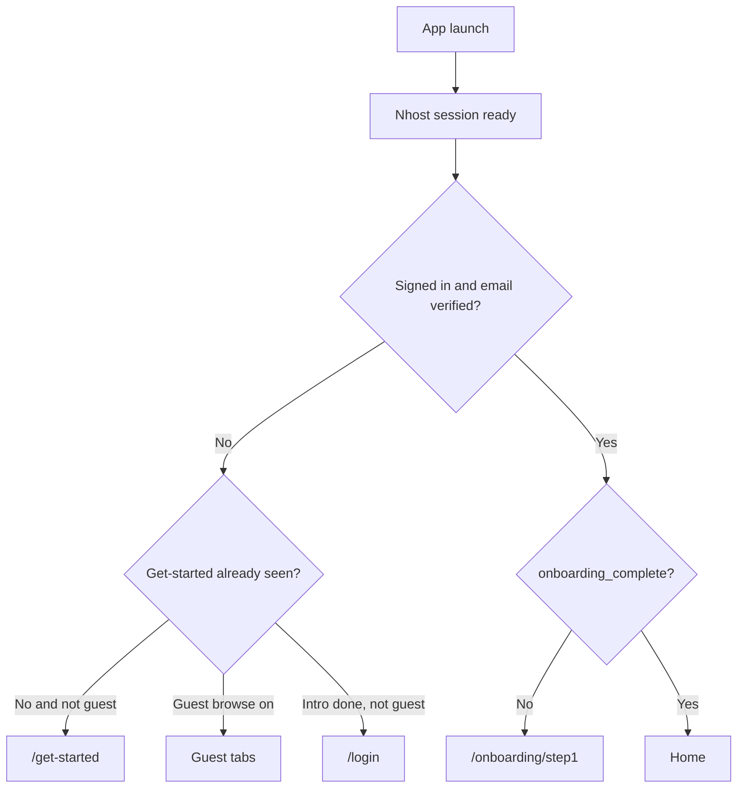
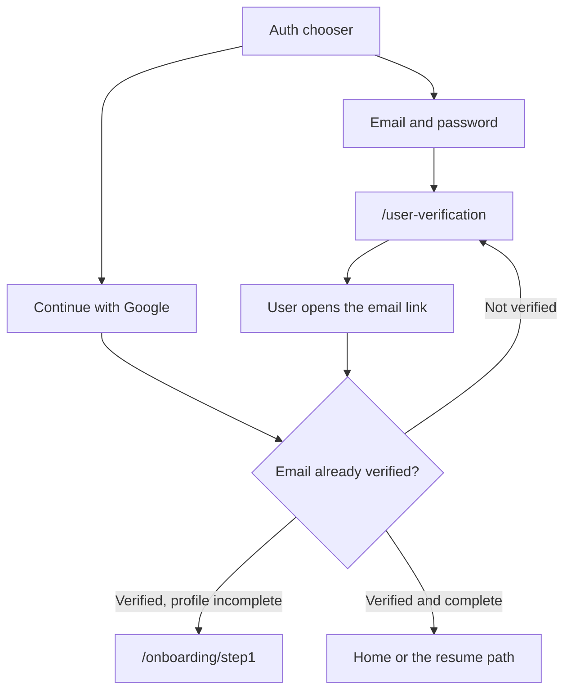
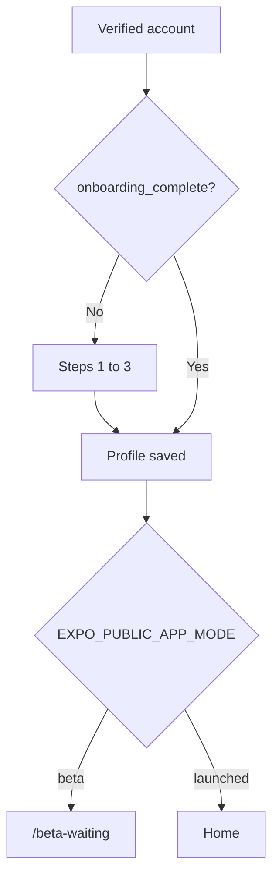

# Tastyplates Mobile — User Flows (v2)

**App:** `tastyplates-mobile` (Expo Router)  
**Status:** Sections 1–11 match the app as it ships today. The app-mode section at the end is the planned beta gate and is not in the binary yet.  
**Last updated:** 2026-10-18

Tastyplates is a restaurant discovery app built around taste identity. People browse by city and cuisine, read reviews from people whose palates match theirs, and publish their own notes from Studio.

Screen paths below are Expo routes. Files often live under `app/(tabs)/`, but links usually omit that group (`/studio/...`, `/restaurants/...`).

Today there is no `EXPO_PUBLIC_APP_MODE`. A verified account with `onboarding_complete` always lands on Home.

---

## How the app decides what to show

On launch, `SplashAuthGate` waits for the Nhost session, then `OnboardingGate` runs. The tab layout then chooses get-started, login, guest tabs, or signed-in tabs.



| Person | Bottom tabs | Profile |
|---|---|---|
| Signed in, onboarding done | Home, Explore, Activity, Studio (+) | Avatar in the top bar. Profile is not a tab. |
| Guest browse | Home, Explore, Profile | Profile tab opens the sign-in sheet and returns to Home. |

Guests can browse Home and Explore. Writing a review, saving, checking in, following, or opening Activity asks them to sign in.

---

## 1. First open and get started

**Route:** `/get-started`

Three slides:

1. Discover by your palate
2. Share your plates
3. Build your food world

- **Create account** marks the intro as seen and opens the auth sheet on the chooser, with skip-to-browse available.
- **Sign in** opens the same sheet already on the sign-in form.
- **Browse as guest** stores guest mode and replaces the screen with Home.

Returning guests skip this screen. Signed-out people who finished the intro and did not choose guest browse are sent to `/login`, which reopens the auth sheet.

---

## 2. Authentication

Auth is a sheet, not a long stack of screens. `/login` is the OAuth return route (`tastyplates://login`) and the fallback that opens that sheet. `/register` is the same sheet in sign-up mode.

### 2.1 Create an account



- Email sign-up collects email and a password of at least 9 characters.
- If the account still needs verification, the app stores the email and replaces the route with `/user-verification`.
- Google skips the password form. A verified Google account continues straight into onboarding or Home.
- Forgot password is `/forgot-password`. The reset link opens `/reset-password`.
- Legal pages: `/terms-of-service`, `/privacy-policy`, `/cookie-policy`, `/content-guidelines`.

Until the email is verified, `OnboardingGate` does not force onboarding.

After a verified sign-in, the app ensures a `user_profiles` row exists, clears guest browse, and replaces the route with Home or the screen the person was trying to open.

### 2.2 Sign in

Same sheet: email and password, or Google.

- Profile unfinished: `/onboarding/step1`.
- Profile saved: Home, unless a resume path was stored (Activity, Studio, profile, and so on).

### 2.3 Sign-in wall

Protected actions open the auth sheet or `/login` and remember where to return. Typical walls:

- Activity tab (inline “Sign in” on the Following screen)
- Studio create-review search (`useRequireAuthOnMount`)
- Save and check-in on a restaurant
- Follow, like, or comment
- Top-bar avatar, and the guest Profile tab

---

## 3. Onboarding

**Routes:** `/onboarding/step1` → `step2` → `step3` → `step4` → `step5`  
**Done when:** `user_profiles.onboarding_complete` is true.

This is the only profile setup. It collects the username, first and last name, display name, current city, hometown, and exactly two cuisine palates. Every step shows a 5-segment progress bar and “Step N of 5”.

`OnboardingGate` checks every verified session that is not already on `/onboarding`. A local “just completed” flag stops a redirect loop on the way to Home. Draft answers stay on the device (`tastyplates_onboarding_registration_v1`).

### Step 1 — Username

- No back button. Starts from the draft, then the existing username, then a generated `user_<random>`.
- Rules: 3–20 characters, letters/numbers/`_`/`-`, no spaces, no leading or trailing `_`/`-`, not all numbers, no `__`, `--` or `_-`.
- Valid names are checked for availability after a short pause.

### Step 2 — Name

- First and last name, both required. Saved as private `user_profiles.first_name` / `last_name`; never shown on their own.

### Step 3 — Display name

- Four variants built from the name: full, first initial + last, first only, last only. Default is full. A preview shows it above `@username`.
- The pick becomes `display_name`. Changeable later in Edit profile → Display name.

### Step 4 — Where you are, and where you are from

- **Current city** becomes the browse city for Home and Explore. **Hometown** only goes on the profile.
- Both are required. “Same as current residence for hometown” copies current into hometown.

### Step 5 — Palate

- “Select 2 cuisines you grew up with.” Exactly two leaf cuisines, as brand icon tiles grouped by region, with search.
- **Done** sends username, names, display name, palates, cities and `onboarding_complete` in one update, clears the draft, refreshes the session, and replaces the stack with Home (toast “Welcome to Tastyplates”).

Skipping steps exists only when `DEV_MODE` is on.

Coming back later does not show these steps again.

---

## 4. Home

**Route:** `/(tabs)`

Top bar on Home, Explore, Activity, and Profile: city on the left, cuisine search and profile avatar on the right. The city picker changes which restaurants and articles are scoped to that place.

The page, top to bottom:

1. Brand mark
2. Hero — “Dine like a Brazilian in Tokyo — or Korean in New York?” Tapping the field opens the full-screen search overlay. Up to two recent searches sit under it and open Explore with that keyword (`listing` param).
3. **Quick finds** — ten cuisine shortcuts, two rows of five. Each opens Explore with that `cuisine` param.
4. **Recommended restaurants** — carousel for the selected city.
5. **Trending reviews** — up to six latest reviews in a two-column grid. A card opens `/reviews/viewer`.
6. **Articles** — up to eight editorial cards for the city. A card opens `/articles/[slug]`. The full list is `/articles`.

Pull to refresh reloads recommended restaurants, trending reviews, and articles. Focusing Home reloads recent searches.

---

## 5. Explore

**Route:** `/(tabs)/restaurants`

Explore is a map with a results sheet, not a full-screen list.

- The map is centered on the selected city. Pinch, pan, and marker taps move the search. Panning debounces and refetches around the new center.
- A bottom sheet holds the cards. Snap points cover a peek, a short list, and a taller list. If the map cannot load, the same cards render in a plain list.
- Cuisine chips filter the sheet. Category and cuisine can also arrive as route params from Quick finds or search.
- Results mix Tastyplates restaurants and nearby Google places that are not listed yet.
- A Tastyplates card opens `/restaurants/[slug]`. A Google card opens `/places/google/[place_id]`.
- When a cuisine filter is active and the person is signed in, cards can show a palate match score.
- Pull to refresh and load-more apply to the sheet.

### Search overlay

Opened from the Home hero and the top-bar cuisine control. It searches restaurants and can send the person to Explore with a keyword, cuisine, or category. Recent searches are stored on the device.

### Restaurant detail

**Route:** `/restaurants/[slug]`

- Photo carousel, name, cuisine and price pills, address
- **Ratings row**
  - **Overall Score** — first-party reviews plus the Google rating prior
  - **Search / group score** — the cuisine filter’s score when they arrived with one (labeled Your Score when it is personalized). With no filter, a signed-in person sees their cuisine **group** score, for example “East Asian Score” for a Chinese or Korean palate. It stays locked until that group has at least 3 reviews.
  - **Authentic Score** — reviews whose reviewer cuisine matches the restaurant, including curated external reviews after a rating rebuild
  - **Shared Score** — unlocked when at least 3 reviews come from people who share the user’s palate
- **Write a Review** opens Studio for this restaurant
- **Save** toggles the wishlist. **Check-in** toggles a visit. Both require sign-in.
- Review previews, then the full list at `/reviews/restaurant`
- Map, directions, phone, menu or website, and about text

### Google-only place

**Route:** `/places/google/[place_id]`

Same detail shell for a place that is not a Tastyplates restaurant yet. Overall falls back to the Google rating. Preference scores stay empty. Write a Review opens Studio search with that place id and name prefilled.

### Cuisine listing

**Route:** `/restaurants/cuisines/[slug]`

A cuisine-scoped browse used when a flow needs a dedicated cuisine screen. Quick finds themselves navigate to Explore with a `cuisine` param.

---

## 6. Reviews

### Read

- Home trending cards and restaurant review rows open `/reviews/viewer`.
- A restaurant’s full list is `/reviews/restaurant`.
- Comments are `/reviews/[reviewId]/comments`.
- Hashtag taps open `/hashtag/[hashtag]`.

The viewer is full-screen and swipeable. Liking and commenting require sign-in.

### Write

Studio **Create a Review** starts at `/studio/add-review`. The screen requires sign-in as soon as it mounts.

1. With an empty query, nearby Tastyplates restaurants and Google places load for the current city. Cuisine pills narrow that list.
2. Typing at least two characters searches both catalogs.
3. Choosing a Tastyplates restaurant opens `/studio/add-review/[slug]`.
4. Choosing a Google place tries to match an existing listing. If none exists, `/studio/add-review/create` starts a listing, then the write form.
5. A prefilled Google place from restaurant detail skips the empty search and runs that match immediately.

The write form (`WriteReviewForm`):

- Half-star rating (required)
- Title, up to 50 characters
- Body, up to 1200 characters (required)
- 1 to 6 photos, 5 MB each (at least one required to publish)
- Recognition tags
- **Save draft** or **Publish**

Publish uploads photos, creates the review, and opens `/studio/add-review/success`. Leaving mid-form shows an exit sheet so a draft is not lost by accident.

Editing an existing note is `/studio/edit-review/[id]`. Drafts and published notes are listed at `/studio/review-listing`.

---

## 7. Activity

**Route:** `/(tabs)/following`  
**Tab label:** Activity

Signed-in only. Signed-out people see a short explanation and a sign-in button that resumes this tab. There is no guest feed.

Once signed in:

- **Suggested users** — a horizontal row. Follow from the card.
- **Following feed** — reviews, comments, and related activity from people they follow, grouped into sections. Pull to refresh. “Show earlier” and “Load more” page through older activity.
- A card opens the review viewer. An author opens `/profile/[userId]`.

---

## 8. Profile and people

### Own profile

**Route:** `/(tabs)/profile`  
Opened from the top-bar avatar. It is not one of the signed-in bottom tabs.

The header shows avatar, @username, display name, bio, palate labels, current city, hometown, member-since, and counts for posts, followers, and following. Followers and following open `/profile/[userId]/connections`.

Three pills:

| Tab | Contents |
|---|---|
| Me | Recent reviews, check-ins, and comments |
| Reviews | Their published notes |
| Lists | Public playlists |

The avatar opens `/profile/edit` (photo, name, about, location). Palates are edited at `/profile/edit-palates`, still capped at two cuisines. Saving palates is what later group scores read. The gear opens Settings.

### Someone else’s profile

**Route:** `/profile/[userId]` (UUID or username)

Same three pills, plus follow. Their reviews are `/profile/[userId]/reviews`.

---

## 9. Studio

The center **+** is a sheet, not a screen. `/studio` with no child redirects to Create a Review.

| Action | Route | What it does |
|---|---|---|
| Create a Review | `/studio/add-review` | Search, then write |
| Manage Reviews | `/studio/review-listing` | Drafts and published notes |
| Manage Lists | `/studio/manage-lists` | Playlists the person curates |
| My Lists | `/studio/my-lists` | Saved restaurants and check-ins |

### My Lists

Two pills:

- **To-Dine** — wishlist from Save
- **Check-ins** — places they checked in

Swipe a row to remove it. Tapping a row opens the restaurant.

### Manage Lists

Playlists, separate from To-Dine and Check-ins. Tabs filter all, public, and private. Create is `/studio/manage-lists/create`. A list opens `/studio/manage-lists/[uuid]`, where they add restaurants (`.../add`) or edit the title and visibility (`.../edit`). Swipe deletes a list. Public lists are the ones that show on the profile Lists tab.

### Add a restaurant

`/listing/explanation`, `/listing/step-1`, `/listing/step-2`, and `/listing/draft` exist as routes. The explanation screen is still a placeholder (“What you need to know before listing”). Creating a place from a Google result during review writing is the path that actually runs today.

---

## 10. Articles

**Routes:** `/articles`, `/articles/[slug]`

Home and the articles list are scoped to the selected city. Reading does not require an account. Articles do not change restaurant scores. The detail screen is an in-app article, addressed by slug or numeric id.

---

## 11. Settings and account

**Route:** `/settings`

The menu that ships is short:

- **Account Security** → `/settings/account-security`
  - **Profile** — email, birthdate, gender (`/settings/account-security/profile`)
  - **Password** — sends a reset email (`/settings/account-security/password`)
- **Log out** — confirms, clears the Nhost session, and returns to get-started

`/settings/general/language` and `/settings/support/about` exist as routes. They are not linked from this Settings screen.

Sign-out does not clear `onboarding_complete`. The next sign-in skips the five steps.

Policies remain available from auth: terms, privacy, cookies, and content guidelines.

---

## 12. Scores, in one pass

These four numbers are what restaurant detail explains. They are not four views of the same average.

| Label | Who it is for | What moves it |
|---|---|---|
| Overall | Everyone | First-party reviews and the Google rating prior |
| Group / Search | Signed-in person, from their palate’s cuisine group | Combined palate summary for that group (for example East Asian) |
| Authentic | Everyone | Reviews whose reviewer cuisine matches the restaurant, including curated external reviews |
| Shared | Signed-in person | Reviews from people who share their palate, once there are at least 3 |

A person with Chinese or Korean selected sees East Asian as their group score when no cuisine filter is active. A cuisine filter replaces that column with Search Score or Your Score. The two palates collected in onboarding are what that group score will use.

---

## 13. Planned app mode (not shipped)

Today every finished profile goes to Home. The plan is one extra flag so a beta build can stop after that same profile instead of opening the rest of the app.

```bash
EXPO_PUBLIC_APP_MODE=beta
# or
EXPO_PUBLIC_APP_MODE=launched
```

If the variable is missing, treat the build as `beta` so a bad release cannot open the product early.

| Mode | After a verified account | How far they can go |
|---|---|---|
| `beta` | The same three onboarding steps, then a waiting screen | Profile only. No Home, Explore, Activity, or Studio. |
| `launched` | The same three steps if they are not done, then Home | The flows in sections 1–12. |

`onboarding_complete` still only means the profile was saved. People who finished it during beta do not fill the form again when the flag flips to `launched`.



Beta keeps the current auth sheet and the current three steps. It does not add invite codes, a waitlist, or a “publish a review” checklist. Guest browse is hidden. **Done** replaces the stack with `/beta-waiting` instead of Home.

Waiting screen copy:

- **Title:** You’re on the list.
- **Body:** We have your username, city, and palate. Tastyplates is still in beta, so browsing and reviews are not open yet. We’ll open the app for this group when the next update is ready.

Actions: edit profile, sign out. No other navigation. Unverified accounts stay on `/user-verification` and never see this screen.

When a build ships with `launched`, this screen is not rendered. The same account opens Home and the tabs in sections 4–11.

---

## Route index

| Flow | Route | Today |
|---|---|---|
| Get started | `/get-started` | Shipped |
| Login / OAuth return | `/login` | Shipped |
| Register | `/register` | Shipped, same sheet |
| Verify email | `/user-verification` | Shipped |
| Forgot / reset password | `/forgot-password`, `/reset-password` | Shipped |
| Onboarding | `/onboarding/step1` … `step5` | Shipped. Done goes to Home. |
| Home | `/(tabs)` | Shipped |
| Explore | `/(tabs)/restaurants` | Shipped. Map and sheet. |
| Restaurant | `/restaurants/[slug]` | Shipped |
| Google place | `/places/google/[place_id]` | Shipped |
| Cuisine browse | `/restaurants/cuisines/[slug]` | Shipped |
| Activity | `/(tabs)/following` | Shipped |
| Create review | `/studio/add-review`, then `[slug]` or `create` | Shipped |
| Review success | `/studio/add-review/success` | Shipped |
| Manage reviews | `/studio/review-listing` | Shipped |
| Edit review | `/studio/edit-review/[id]` | Shipped |
| My Lists | `/studio/my-lists` | Shipped. To-Dine and Check-ins. |
| Manage Lists | `/studio/manage-lists` | Shipped. Playlists. |
| Own profile | `/(tabs)/profile` | Shipped, via avatar |
| Edit profile / palates | `/profile/edit`, `/profile/edit-palates` | Shipped |
| Public profile | `/profile/[userId]` | Shipped |
| Review viewer | `/reviews/viewer` | Shipped |
| Restaurant reviews | `/reviews/restaurant` | Shipped |
| Comments | `/reviews/[reviewId]/comments` | Shipped |
| Hashtag | `/hashtag/[hashtag]` | Shipped |
| Articles | `/articles`, `/articles/[slug]` | Shipped |
| Settings | `/settings`, `/settings/account-security` | Shipped |
| Add-restaurant listing | `/listing/explanation` and the step routes | Routes exist. Explanation is a placeholder. |
| Beta waiting | `/beta-waiting` | Not built. Planned for `beta` mode only. |
